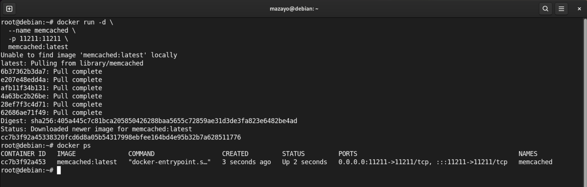
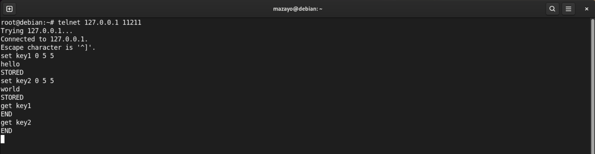
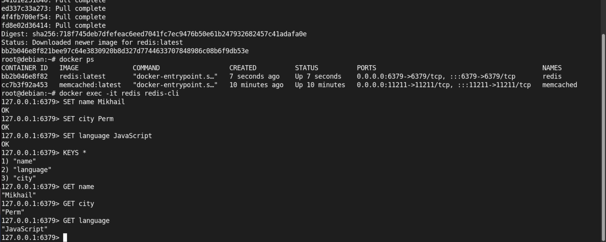
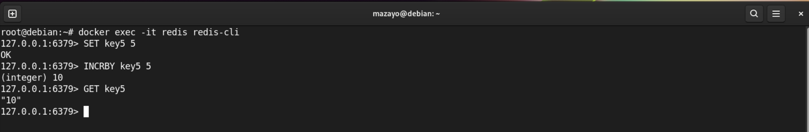

# Практическое задание с самопроверкой "`Кеширование Redis/memcached`" - `Насибуллин Михаил`

## Задание 1. Кеширование

Приведите примеры проблем, которые может решить кеширование. 
Приведите ответ в свободной форме.

## Ответ:

Кеширование помогает решить несколько проблем:

- снижает нагрузку на базу данных или сервер;
- ускоряет загрузку страниц и получение данных;
- уменьшает количество повторных запросов к одним и тем же данным;
- помогает быстрее обслуживать большое количество пользователей;
- снижает задержки при работе приложения.

Например, если пользователи часто запрашивают один и тот же список товаров, его можно хранить в кеше и не обращаться каждый раз к базе данных.

---

## Задание 2. Memcached

Установите и запустите memcached. 
Приведите скриншот systemctl status memcached, где будет видно, что memcached запущен.

## Ответ:

Memcached запущен в докере

---

## Задание 3. Удаление по TTL в Memcached

Запишите в memcached несколько ключей с любыми именами и значениями, для которых выставлен TTL 5. 
Приведите скриншот, на котором видно, что спустя 5 секунд ключи удалились из базы.

## Ответ:

---

## Задание 4. Запись данных в Redis

Запишите в Redis несколько ключей с любыми именами и значениями. 
Через redis-cli достаньте все записанные ключи и значения из базы, приведите скриншот этой операции. 

## Ответ:

---

## Задание 5. Работа с числами*

Запишите в Redis ключ key5 со значением типа “int” равным числу 5. Увеличьте его на 5, чтобы в итоге в значении лежало число 10. 

Приведите скриншот, где будут проделаны все операции и будет видно, что значение key5 стало равно 10.

## Ответ:

